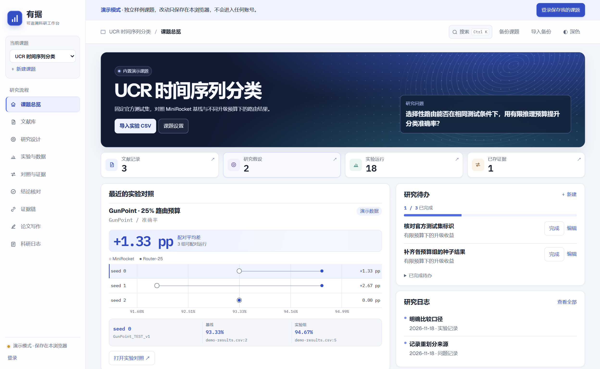
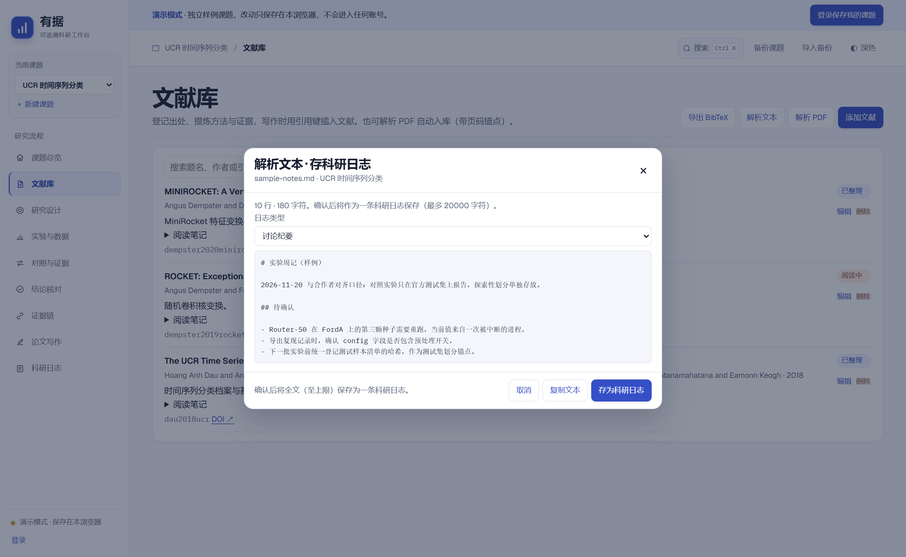
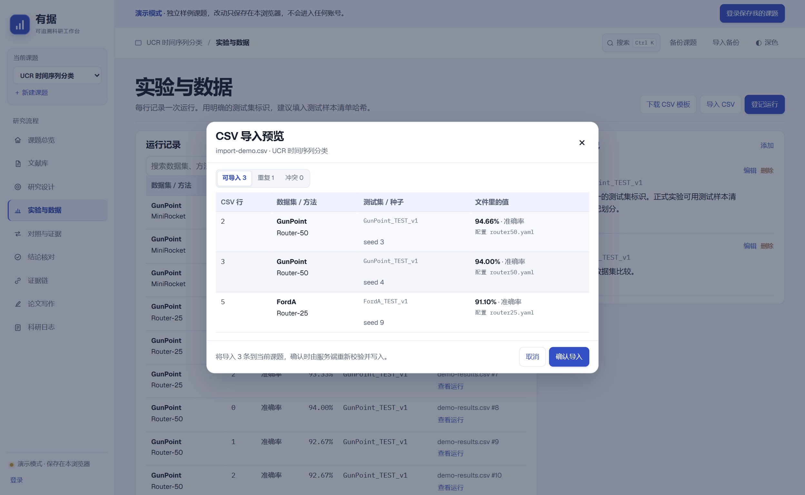
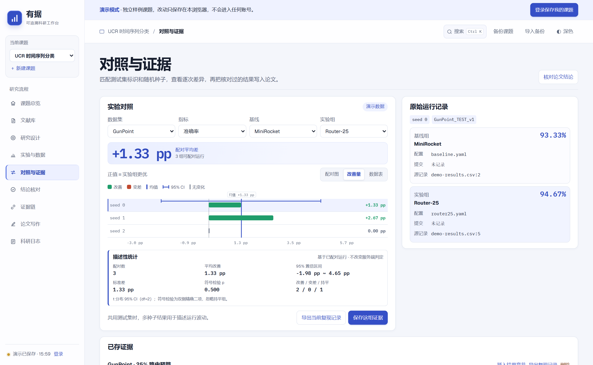
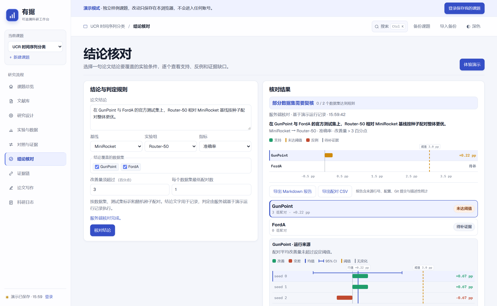
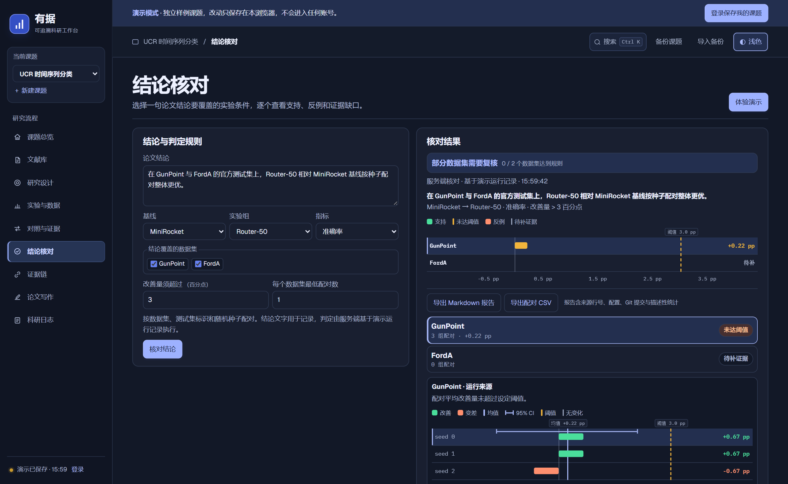
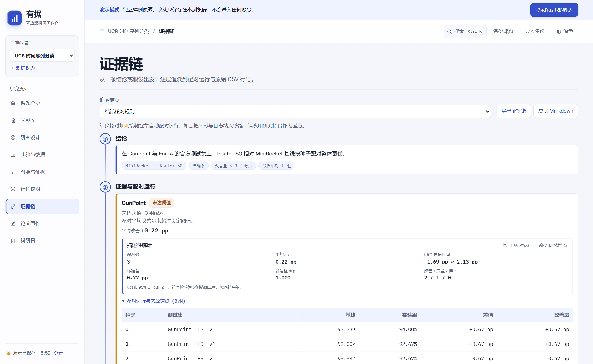
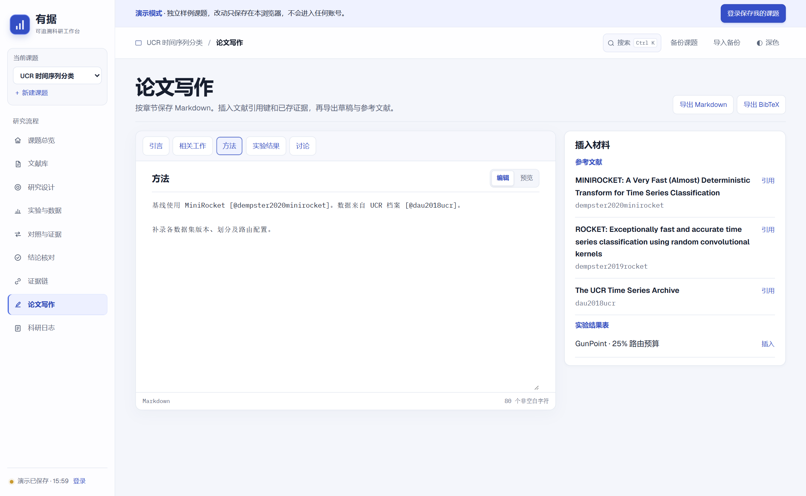

# 有据 · 可追溯科研工作台（ResearchTrace）

> 让每一句科研结论都有据可查。

[](https://research-bench-q1cbl7xind2.qoder.zone)
[](https://qoder.com)
[](#许可证)

**有据**是一个面向科研实验记录的全栈工作台。它把**数据集 + 测试集划分 + 随机种子 + 配置 + CSV 行号**作为贯穿全链路的锚点：导入产出坐标，配对带着坐标，结论核对里的每一组支持/反例都能还原到原始记录的那一行。

- **在线体验（免登录）**：<https://research-bench-q1cbl7xind2.qoder.zone> — 打开首页点「免登录体验」即可进入内置样例课题，导入 CSV、核对结论、查看证据链都能实际操作，改动只保存在本浏览器。
- **服务端判定**：结论核对不在浏览器里"口算"，由服务端基于已保存的运行记录执行确定性配对规则，天然可复现。

---

## 目录

- [为什么做](#为什么做)
- [设计原则](#设计原则)
- [功能总览](#功能总览)
- [模块详解](#模块详解)
  - [课题总览](#课题总览)
  - [文献库与文件解析](#文献库与文件解析)
  - [研究设计与科研日志](#研究设计与科研日志)
  - [实验与数据：CSV 导入](#实验与数据csv-导入)
  - [对照与证据：改善量可视化](#对照与证据改善量可视化)
  - [结论核对：服务端判定与统计](#结论核对服务端判定与统计)
  - [证据链：可追溯视图](#证据链可追溯视图)
  - [论文写作](#论文写作)
- [技术架构](#技术架构)
- [服务端 API](#服务端-api)
- [数据契约与容量上限](#数据契约与容量上限)
- [目录结构](#目录结构)
- [本地开发与测试](#本地开发与测试)
- [部署](#部署)
- [已知局限](#已知局限)
- [许可证](#许可证)

---

## 为什么做

跑实验、写论文的真实流程卡在四个地方：

1. **结论对不上记录。**"提升了准确率"——哪个数据集？哪个划分？哪个种子？哪份配置？浏览器里算出来的差值，没法保证和云端真正保存的记录一致。
2. **导入即提示成功。**点确认页面立刻弹"已导入"，可云端还没确认保存；缺少必填字段的运行记录也能被存进去。
3. **旧数据被悄悄上传。**云端工作区为空时，页面自动把同一浏览器里的旧数据上传到当前账号，上传完成前就提示成功。
4. **演示要先登录。**评委想直接体验，却被"前往登录"挡在门外。

「有据」针对这四点逐条给出服务端可验证的答案。

## 设计原则

| 原则 | 落地方式 |
|---|---|
| **服务端判定才算数** | 结论核对由服务端基于已保存记录执行配对规则，返回支持/反例/证据不足及对应的 CSV 行号、随机种子和配置。判定是确定性规则，不经过模型，天然可复现。 |
| **原子写入 + 幂等** | 导入由后端重新校验、去重并一次性写入，保存成功后才提示；重复提交同一份 CSV 不新增记录。 |
| **免登录可体验，账号仍隔离** | 演示用独立样例课题和匿名无状态接口，改动只保存在本浏览器；登录后的课题按账号保存在云端，迁移需用户确认。 |

## 功能总览

| 能力 | 前端模块 | 后端能力 |
|---|---|---|
| 课题与文献管理 | 课题总览 / 文献库 | 整态版本化保存，按账号隔离 |
| PDF / 文本文件解析 | 文献库 / 科研日志 | 浏览器 pdf.js 提取逐页文本与页码，结果经服务端校验保存 |
| 研究设计与任务追踪 | 研究设计 / 科研日志 | 假设、任务、日志随工作区持久化 |
| 实验记录与细粒度导入 | 实验与数据 | 服务端 CSV 校验、去重、原子写入 |
| 抗幻觉结论核对 | 结论核对 | 服务端基于已保存记录执行配对规则 |
| 改善量可视化 | 对照与证据 / 结论核对 | 发散条形图 + 均值线 + 95% CI 须线 + 阈值线，语义色区分 |
| 证据链 / 可追溯视图 | 证据链 | 结论→证据→配对运行→原始 CSV 行号逐层追溯 |
| 配对统计严谨化 | 对照与证据 / 结论核对 | t 分布 95% CI 与双侧符号检验，仅作描述性推断 |
| 核对报告一键导出 | 结论核对 | Markdown 报告 + 配对明细 CSV |
| 对照证据与复现导出 | 对照与证据 | 按种子/划分配对，导出 Markdown 复现记录 |
| 论文写作辅助 | 论文写作 | 分节草稿 + 引用键，Markdown 排版 |
| 免登录可验证演示 | 首页「免登录体验」 | 匿名无状态 demo 接口，不触碰账号数据 |
| 旧数据迁移 | 启动迁移确认页 | 用户确认后才上传，成功才清旧键 |

## 模块详解

### 课题总览

进入工作台先看到课题的研究问题、文献/假设/运行/证据四类计数、最近一组实验对照（配对图 + CSV 行号）、研究待办进度与研究日志。



### 文献库与文件解析

文献库登记出处、提炼方法与证据，写作时用引用键插入文献；支持导出 BibTeX。「解析 PDF」用浏览器端 pdf.js 逐页提取文本层并记录页码锚点，启发式识别题名/作者/年份/摘要/参考文献（每条参考文献标注所在页）；「解析文本」把 txt/md/log 提取为一条科研日志。原始文件不上传，解析结果走现有服务端校验保存通道。



### 研究设计与科研日志

假设、任务、日志随工作区持久化；每个条目可设置「关联假设」，删除假设时自动解除运行/证据/日志/待办/文献的关联，不留悬空引用。

### 实验与数据：CSV 导入

每一行 CSV 对应一次运行：`dataset, method, seed, split, metric, value, config, note`。导入前先预览可导入/重复/冲突条数，确认后由**服务端**重新校验、去重并原子写入，成功才提示「已导入」；重复提交同一份 CSV 不新增记录，缺少必填字段的记录会被拒绝。



### 对照与证据：改善量可视化

按种子和测试集划分逐次配对，三种视图切换：

- **配对图**：基线/实验组逐种子对照，点击联动右侧原始运行记录（CSV 行号、种子、配置）；
- **改善量**：以零线为基准的发散条形图，准确率/F1 换算成百分点、RMSE/延迟按"越低越好"取反，叠加均值线与 95% CI 须线、阈值线，支持/未达/反例/待补用语义色并附数值标签（颜色不是唯一通道）；
- **数据表**：逐行明细。

一组对照可保存为证据，供结论核对与证据链引用；也可导出 Markdown 复现记录。



### 结论核对：服务端判定与统计

选一句论文结论，配好基线、实验组、指标、覆盖数据集与阈值，提交后**服务端**基于已保存记录逐数据集判定 `支持 / 未达阈值 / 反例 / 待补证据`，每组配对携带 `seed / split / config / commit / source / row`。判定不经过模型——"有没有据"是可断言的结果。

页面同时提供跨数据集总览与逐配对分布图，以及描述性统计面板（配对数、平均改善、t 分布 95% 置信区间、标准差、双侧符号检验 p 值）。统计由浏览器基于服务端返回的配对结果计算，**只作描述性推断，不改变服务端判定**。



核对结果可一键导出 Markdown 报告（判定依据、逐数据集原因、配对表、来源锚点表、描述性统计、未配对运行）与配对明细 CSV（20 列，带 BOM，Excel 直接打开）。



### 证据链：可追溯视图

选一个锚点（结论核对规则、研究假设或某组已存证据），逐层展开**结论 → 证据与配对运行 → 直接关联的运行 → 关联材料**。每组证据带判定标签、平均改善、描述性统计，以及可展开的来源锚点表——数据集、测试集划分、随机种子、配置、CSV 行号、Git 提交一行行列清楚。整条链路可一键导出或复制 Markdown。证据链是派生视图，不新增持久化实体，服务端校验与备份恢复完全不受影响。



### 论文写作

按章节保存 Markdown 草稿（引言/相关工作/方法/实验结果/讨论），右侧把文献引用键和已存证据一键插入；写作页底部实时预览 Markdown 排版，可导出草稿与 BibTeX。



### 移动端

窄屏下侧栏折叠为横向模块条，图表与表格自适应，无横向溢出。


---

## 技术架构

```
浏览器（原生 HTML/CSS/JS，无框架、无构建）
  ├─ marked（MIT）          本地 Markdown 排版
  ├─ pdf.js（Apache-2.0）   浏览器端 PDF 逐页文本提取
  └─ fetch（同源）          仅请求同源 /functions/v1/app/*
        │
        ▼
Edge Function（Deno.serve，一个 app 函数）
  ├─ functions/index.ts     部署入口，注入 _qoder/backend.mjs
  ├─ functions/routes.mjs   业务路由（匿名 demo + 登录账号两条通道）
  └─ functions/core.mjs     权威业务规则：校验 / CSV 解析 / 配对 / 结论判定
        │
        ▼
函数后端数据库  app.workspaces（owner_id 主键 · state jsonb · version 整数）
```

- **身份**：由平台注入的 `x-qoder-user-context` 提供，浏览器从不提交 owner 字段，也不持有任何凭据。
- **整态写入 + 乐观并发**：`version 0` 表示首次创建，之后按当前版本条件更新并自增；版本不匹配返回 409 `write_conflict`，前端提示备份后重新加载。
- **浏览器预览镜像规则**：前端在提交前用同一套规则做预检，但**服务端才是权威**——两端共享 `core.mjs` 的规则定义。

## 服务端 API

| 方法 | 路径 | 鉴权 | 说明 |
|---|---|---|---|
| GET | `/api/health` | 匿名 | 健康检查 |
| POST | `/api/demo/import` | 匿名 | 演示 CSV 校验/去重（无状态，不落库） |
| POST | `/api/demo/verify` | 匿名 | 对访客自带运行记录执行同一套判定，返回 `basis: "demo"` |
| GET | `/api/state` | 登录 | 读取当前账号工作区（含账号名、版本） |
| PUT | `/api/state` | 登录 | 整态版本化写入（乐观并发） |
| POST | `/api/import` | 登录 | 服务端 CSV 重新校验、去重、原子合并 |
| POST | `/api/verify` | 登录 | 基于已保存记录执行配对判定，带行号/种子/配置 |

## 数据契约与容量上限

状态结构为 `{ version: 1, active, projects }`。运行记录必填字段 `dataset / method / seed / split / metric / value`，指标合法且数值有限，否则保存被拒绝。

| 上限 | 值 | 超限行为 |
|---|---|---|
| 请求体 | 4 MB | 413 拒绝 |
| 序列化状态 | 3.5 MB | 413 拒绝 |
| 单份 CSV | 2 MB | 413 拒绝 |
| 运行记录数 | 20000 条 | 413 拒绝 |
| PDF 解析 | 20 MB（仅文本层） | 报错提示，扫描件无 OCR |
| 文本解析 | 1 MB，存日志截断 20000 字符 | — |

## 目录结构

```
research-bench-frontend/
├── web/                      # 前端静态文件（发布目录）
│   ├── index.html
│   ├── assets/
│   │   ├── app.css           # 设计 token、组件样式、图表与响应式
│   │   └── fonts/            # 自托管字体拉丁子集（OFL）
│   └── js/
│       ├── data.js           # 项目结构、演示数据、CSV 解析、配对、导出
│       ├── view.js           # 各工作区渲染 + 云端同步状态机
│       ├── actions.js        # 编辑、导入导出、页面操作
│       ├── parse.js          # 浏览器端 PDF/文本解析与预览
│       ├── marked.umd.js     # Markdown 排版（MIT）
│       └── pdf.min.js        # pdf.js（Apache-2.0）
├── functions/
│   ├── index.ts              # Deno.serve 部署入口
│   ├── routes.mjs            # 业务路由
│   └── core.mjs              # 服务端权威业务规则
├── dev/
│   ├── server.mjs            # 本地预览 + 真实路由 + 内存夹具
│   └── check-routes.mjs      # 27 项无凭据路由检查
├── schema.sql                # app.workspaces 建表脚本
├── docs/screenshots/         # README 截图
└── LICENSE                   # Apache-2.0（见下）
```

## 本地开发与测试

无需安装依赖（Node ≥ 18）：

```bash
node dev/server.mjs 8787      # http://127.0.0.1:8787 静态预览 + 真实路由
node dev/check-routes.mjs     # 27 项无凭据路由检查
```

路由检查覆盖：匿名健康检查、登录隔离、版本冲突、非法状态/非法版本/非 JSON/超大数据拒绝、服务端导入原子性与幂等、非法 CSV 安全报错、服务端核对带行号/种子/配置、匿名演示导入与核对、工作区大小上限。

本地夹具开关（仅开发用）：`/__local/fail-on|fail-off` 模拟服务故障，`/__local/anon-on|anon-off` 模拟未登录。夹具数据不证明云端隔离；部署后需以真实账号验证。

## 部署

通过 Qoder Sites 发布：静态前端（`web/`）+ 一个 `app` Edge Function（`functions/`）+ 函数后端数据库（`schema.sql`）。发布后在生产 Deno 运行时复验匿名演示导入与核对。

## 已知局限

| 能力 | 当前状态 | 影响 |
|---|---|---|
| PDF 解析 | 浏览器文本层提取 | 不做 bbox 版式/公式/表格还原；扫描件无 OCR |
| 模型问答 | 未接入 | 结论核对是确定性配对规则，不做自然语言生成（这也是可复现的来源） |
| 存储粒度 | 整态 jsonb | 以工作区为单位版本化写入，非逐行记录表；超大规模需分片 |
| 协作 | 单账号隔离 | 按账号私有，无多人协同编辑 |
| 演示数据 | 仅本浏览器 | 演示改动不进入任何账号，清缓存即丢失 |
| 多端冲突 | 版本重载 | 冲突时提示备份后重新加载，不做自动三方合并 |

## 许可证

- **本项目代码**：Apache-2.0（仓库根目录附 `LICENSE` 与 `NOTICE`）。
- **第三方依赖**：
  - marked — MIT（`web/LICENSE-marked.md`）
  - Mozilla pdf.js — Apache-2.0（`web/LICENSE-pdfjs.md`）
  - 自托管字体 Geist / Instrument Sans / IBM Plex Mono — SIL Open Font License，仅含拉丁子集 woff2，中文回退系统字体
- **密钥与数据**：源码、日志与文档不包含任何密钥；身份与数据库访问由平台注入，浏览器不持有凭据。
